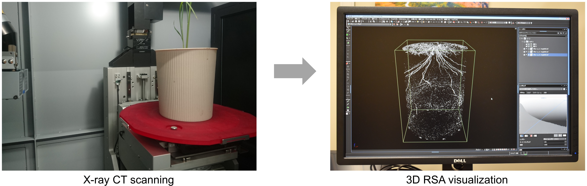
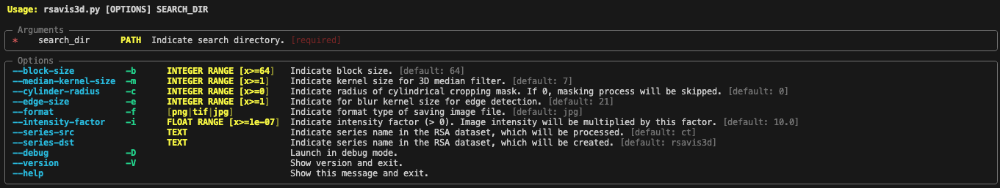

# RSAvis3D: Robust and Rapid Image Processing for Root Segmentation from X-ray CT Images



RSAvis3D is a Python-based tool for segmenting roots from X-ray computed tomography (CT) images. It combines a 3D median filter with an edge detection algorithm to efficiently isolate root structures from surrounding soil. The program is designed to run efficiently without requiring a GPU, enabling fast image processing on standard hardware and reducing overall system costs.

## Limitations
* The method is based on relatively simple image-processing techniques, and Its performance depends on factors such as plant species, soil type, imaging conditions, and the choice of image-processing parameters.
* **Only 8-bit grayscale images are supported** as input. If you wish to process 16-bit grayscale images or other formats, they must be converted to 8-bit images in advance. Based on empirical experience, the method works well when air is mapped to zero and the soil signal is scaled to avoid saturation.

## Installation

This program has been tested on macOS (M1 Pro) with Python 3.12 and the `uv` package manager. The following commands install RSAvis3D and all required dependencies:

```bash
git clone https://github.com/st707311g/RSAvis3D.git
cd RSAvis3D
uv sync
```

## How to run



The basic usage of RSAvis3D is:

```bash
uv run rsavis3d.py [OPTIONS] SEARCH_DIR 
```

RSAvis3D recursively scans the directories under SEARCH_DIR. It automatically detects directories that follow the RSA dataset structure and performs the image conversion. A description of the RSA dataset structure is available here [here](https://github.com/st707311g/public_data/releases/tag/ct_volumes).

The parameters of RSAvis3D can be modified using the `-b`, `-m`, and `-e` options. If omitted, default values based on the conditions described in [the paper](https://doi.org/10.1186/s13007-020-00612-6) will be used. The `-c` option generates a mask image used for trimming the volume by creating a circular mask with a radius of c pixels centered on the XY slice, and applies this mask during the trimming process.

Please adjust the signal intensity with the `-i` option to improve the visibility of the extracted root segments, as their quality depends on the contrast between roots and soil.

## Demonstration

Please download the demo dataset (1.65 GB), which contains time‑series X‑ray CT images of an upland rice cultivar from 7 to 27 days after sowing ([Teramoto et al. 2020 Plant Methods](https://plantmethods.biomedcentral.com/articles/10.1186/s13007-020-00612-6)). The intensities in this dataset were normalized: CT slice images were converted into 8‑bit JPEG files, with the air signal intensity approximately 0 and the soil signal intensity approximately 128.

```bash
wget https://github.com/st707311g/public_data/releases/download/ct_volumes/01_rice_daily_growth.zip
unzip 01_rice_daily_growth.zip
rm 01_rice_daily_growth.zip
```

The directory `01_rice_daily_growth` contains 21 subdirectories:

```
ls 01_rice_daily_growth/
```

### Running RSAvis3D
Execute RSAvis3D on the downloaded dataset. If you want to crop the processed volume with a smaller diameter than the pot (as described in the paper), use the -c option:

```bash
uv run rsavis3d.py 01_rice_daily_growth/ -c 300
```

Here, 300 is the radius in pixels. Given that the CT resolution is 0.3 mm/voxel, this corresponds to a diameter of 180 mm.

### Output Files
Processed files are saved as `01_rsavis3d.zip`. By default, the output images are stored in 8-bit grayscale JPEG format; however, formats other than JPEG can be selected using the `-f` option.

### Creating Projection Images

Projection images can be generated using the following command:

```bash
python make_projection.py 01_rice_daily_growth/ --axis z
```

This example creates a projection along the z-axis.
Below are sample animations generated from RSAvis3D output:

 

## Citation

Please cite the following article:

Shota Teramoto et al. (2020) [High-throughput three-dimensional visualization of root system architecture of rice using X-ray computed tomography.](https://doi.org/10.1186/s13007-020-00612-6)  Plant Methods. 16, Article number: 66
